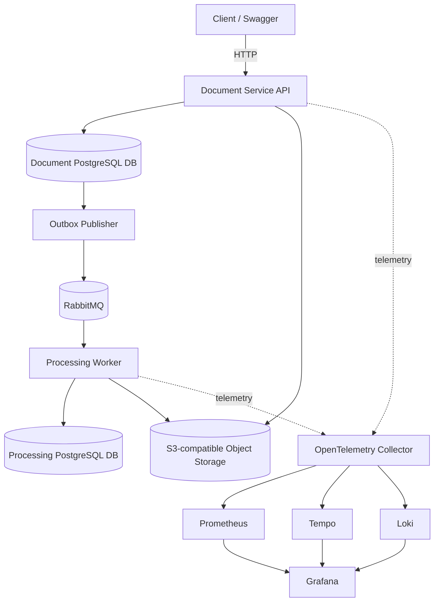

# DocFlow Architecture

**Status:** Initial architecture baseline; validate each decision as implementation is built.

## 1. System context

DocFlow accepts documents for asynchronous processing and exposes status to clients. The initial runtime is local Docker Compose.

This is a target design, not a claim that all components are implemented.

## 2. Runtime components

### Document Service API
Owns document submission and metadata. It provides synchronous HTTP endpoints and writes an outbox event atomically with metadata. File bytes are stored in object storage; the database stores a stable object key and metadata, not the entire file.

### Outbox Publisher
Initially may run as a hosted background service within the Document Service deployment. It reads pending outbox records, publishes messages, and marks them as dispatched only after broker confirmation. Duplicate publication is possible and expected.

### Processing Worker
A separate deployable .NET Worker Service. It consumes events, obtains the object by key, performs deterministic processing, and records its result in its own database. It must tolerate duplicate events and restart safely.

### PostgreSQL
For local simplicity, one PostgreSQL container may host two separate databases (`docflow_documents` and `docflow_processing`) or separate schemas with strict ownership. Separate logical databases are preferred. Each service uses its own credentials where practical. A shared database server for local development does not imply shared ownership.

### RabbitMQ
Carries versioned integration events. Queues, durable delivery, publisher confirms, acknowledgements, retry policy, and dead-letter handling will be configured deliberately. Queue topology is documented and tested.

### Object storage
MinIO provides an S3-compatible local endpoint. Use opaque object keys, not user-provided file paths. Upload consistency and cleanup of orphaned objects need explicit handling.

### Telemetry
Applications instrument HTTP, database, and messaging boundaries with OpenTelemetry. The Collector receives OTLP telemetry and exports it to:
- Prometheus-compatible metrics endpoint for scraping.
- Tempo for distributed traces.
- Loki for structured logs, using a supported OTLP ingestion path.

Grafana queries these backends. Exact exporter and image versions must be verified during implementation.

## 3. Service boundaries and data ownership

| Concern | Owner | Persistence |
|---|---|---|
| Document metadata and submission state | Document Service | Document DB |
| Outbox records | Document Service | Same transaction/database as metadata |
| Processing attempts and outcomes | Processing Worker | Processing DB |
| File bytes | Document Service owns lifecycle; object storage stores bytes | MinIO/S3 |
| Event transport | RabbitMQ | Durable queues and broker state |

No service reads another service's database. Status needed by the API should be obtained through a deliberate API/query strategy or a locally maintained projection in a later phase. The initial API can return submission status owned by Document Service and expose processing status through a documented eventual-consistency approach once the contract is implemented.

## 4. Initial workflow

1. Client uploads a file and metadata to the Document Service.
2. API validates request size, allowed type, and metadata.
3. File is stored under an opaque object key.
4. A database transaction persists document metadata and an outbox event. Because object storage is outside the database transaction, failure and cleanup compensation must be handled explicitly.
5. Outbox publisher publishes `DocumentSubmitted` to RabbitMQ with a stable `eventId`, schema version, and trace context.
6. Worker consumes the event and checks its idempotency record.
7. Worker fetches the object, processes it, and stores outcome plus idempotency state in one database transaction where possible.
8. Worker acknowledges the message after durable success. Transient failures follow bounded retry; permanent/poison failures eventually reach the DLQ.
9. Traces, metrics, and logs allow the end-to-end workflow to be diagnosed.

## 5. Delivery and consistency guarantees

- RabbitMQ delivery is treated as **at least once**.
- A publisher may publish an event and crash before marking the outbox row dispatched; the event may be published again.
- A consumer may commit work and crash before acknowledging; the event may be redelivered.
- Idempotency protects business effects from duplicate deliveries.
- Outbox reduces the database-plus-broker dual-write risk but does not create a distributed transaction.
- Cross-service status is eventually consistent.
- Exactly-once end-to-end processing is not claimed.

## 6. API principles

- Use resource-oriented REST endpoints and consistent status codes.
- Return `ProblemDetails`-style error responses without internal stack traces.
- Validate request size and content type at the boundary.
- Use pagination if list endpoints are introduced.
- Define idempotency behavior for submission where duplicate client requests are a concern.
- Version public contracts deliberately; avoid versioning every endpoint before it is needed.
- OpenAPI is the API contract for HTTP endpoints; event schemas are separately documented.

## 7. Resilience

- Set explicit timeouts for outbound HTTP calls.
- Propagate cancellation tokens.
- Retry only transient failures and use bounded exponential backoff with jitter where appropriate.
- Use a circuit breaker only around an actual remote dependency when it adds value.
- Avoid retry multiplication across layers.
- Use queue TTL, retry limits, and DLQ policy to prevent infinite poison-message loops.
- Implement graceful shutdown so consumers stop taking new work and finish/abandon in-flight work safely.

## 8. Observability

Every service should provide:
- Liveness and readiness checks with distinct meanings.
- Request/processing duration and outcome metrics.
- Structured logs with service name, environment, trace ID, span ID, and relevant business identifiers (not secrets).
- Distributed traces across HTTP, database, and messaging operations.
- Dashboards and actionable alerts with runbooks.

Avoid high-cardinality metric labels such as document IDs, user IDs, filenames, or trace IDs.

## 9. Deployment model

Initial target: Docker Compose on a developer machine. Each service is independently built and run, but the repository is a monorepo. Kubernetes is deferred until deployment requirements justify it.

## 10. Security baseline

- Local-only development credentials in ignored environment files.
- No secrets in Git.
- Least-privilege database and broker users.
- Upload size and file-type controls.
- Opaque object keys and no direct path concatenation from user input.
- Avoid logging document contents or secrets.
- Explicit network exposure: only necessary ports are published to the host.
- Authentication/authorization will be added only with a defined threat model and use case; no fake production-security claim.

## 11. Open questions to resolve through implementation

- Exact event schema and compatibility policy.
- Document status ownership and read model.
- File-upload streaming strategy and object-store cleanup behavior.
- Retry queue topology and delayed retry implementation.
- Exact OTLP exporters and Collector pipeline supported by pinned versions.
- Authentication needs for the final demonstrator.
